<div align="center">


<a href="https://git.io/typing-svg"></a>

<br/>

<!-- Tech badges -->


<br/>

[](https://www.linkedin.com/in/rensee-gajipara)
[](mailto:renseegajipara@gmail.com)
[](https://github.com/RENSEE-GAJIPARA)

</div>

---

## 📑 Table of Contents

- [🎯 Project Overview](#-project-overview)
- [📊 Dataset](#-dataset)
- [🧭 Methodology](#-methodology)
- [🔍 Exploratory Data Analysis](#-exploratory-data-analysis)
- [🔴 K-Means Clustering](#-k-means-clustering)
- [🌳 Agglomerative Hierarchical Clustering](#-agglomerative-hierarchical-clustering)
- [⚫ DBSCAN](#-dbscan)
- [⚖️ Algorithm Comparison](#️-algorithm-comparison)
- [💼 Business Insights](#-business-insights)
- [🎬 Demo Video](#-demo-video)
- [📁 Repository Structure](#-repository-structure)
- [⚙️ Installation & Usage](#️-installation--usage)
- [🛠️ Tech Stack](#️-tech-stack)
- [👤 Author](#-author)

---

## 🎯 Project Overview

A mall wants to know **who its customers really are** — not by guesswork, but by behaviour. This project applies **three unsupervised learning algorithms** to the *Mall Customer Segmentation* dataset to discover natural customer groups based on **annual income** and **spending score**, then translates each group into an actionable marketing strategy.

| | |
|---|---|
| **Course** | Unsupervised Learning — Red & White Skill Education |
| **Project** | Practical Report 1 (PR 1) |
| **Algorithms** | K-Means · Agglomerative Hierarchical (Ward) · DBSCAN |
| **Goal** | Segment 200 customers and compare algorithm behaviour |
| **Key Result** | **5 customer segments**, silhouette ≈ **0.55** (K-Means & Hierarchical) |

<div align="center">


</div>

## 📊 Dataset

| Field | Detail |
|---|---|
| **Name** | Mall Customer Segmentation Data |
| **Source** | [](https://www.kaggle.com/datasets/vjchoudhary7/customer-segmentation-tutorial-in-python) |
| **File** | `Mall_Customers.csv` — 200 rows × 5 columns |
| **Quality** | No missing values, no duplicates |
| **Domain** | Retail / Customer Analytics |
| **License** | CC0: Public Domain |

| Column | Type | Description |
|---|---|---|
| `CustomerID` | Integer | Unique identifier (1–200) — dropped before modelling |
| `Gender` | Categorical | Male / Female — label-encoded (Female = 0, Male = 1) |
| `Age` | Integer | Age in years (18–70) |
| `Annual Income (k$)` | Numeric | Annual income in thousand USD (15–137) → renamed `Annual_Income` |
| `Spending Score (1-100)` | Integer | Mall-assigned score based on purchase frequency and amount → renamed `Spending_Score` |

## 🧭 Methodology

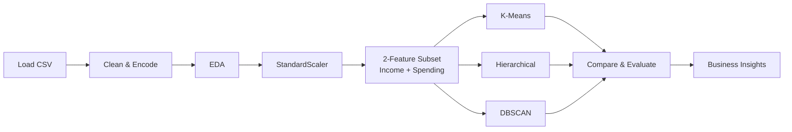

1. **Preprocessing** — drop `CustomerID`, rename columns, encode `Gender`.
2. **Scaling** — `StandardScaler` on `Age`, `Annual_Income`, `Spending_Score`, so no feature dominates distance calculations because of its raw range.
3. **Feature selection** — `Annual_Income` and `Spending_Score` (`df_2f`) give clearly separable groups and allow direct 2D visualisation without PCA.
4. **Modelling** — K-Means, Agglomerative (Ward linkage), and DBSCAN.
5. **Evaluation** — Elbow method, silhouette score, dendrogram, k-distance plot, and side-by-side visual comparison.

## 🔍 Exploratory Data Analysis

### Univariate Distributions

<div align="center">
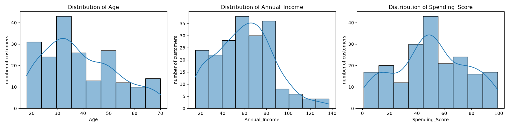
</div>

- **Age** is right-skewed, with most customers between 20 and 50.
- **Annual Income** is roughly bell-shaped, with a long right tail up to ~137k$.
- **Spending Score** is centred near 50, with spread at both extremes.

### Pairplot

<div align="center">
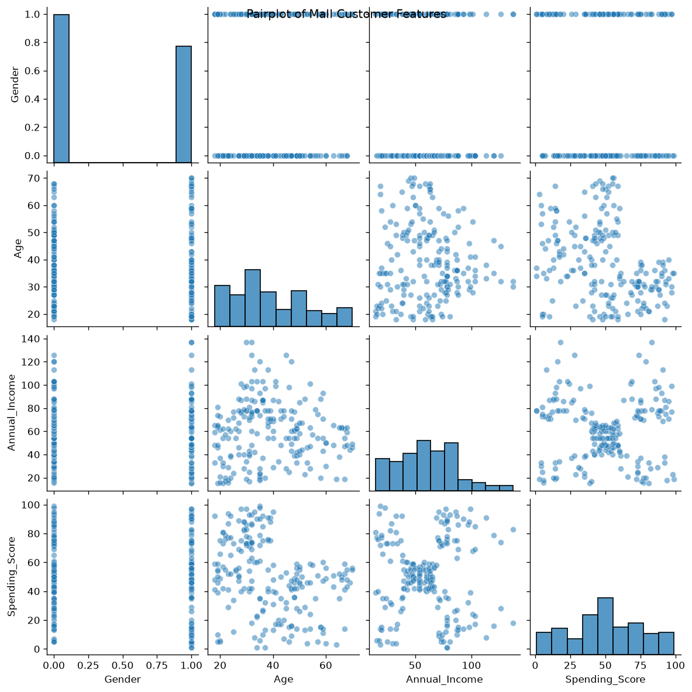
</div>

The **Annual Income vs Spending Score** panel shows five visibly distinct groups, which is why this pair was selected for clustering.

### Correlation Heatmap

<div align="center">
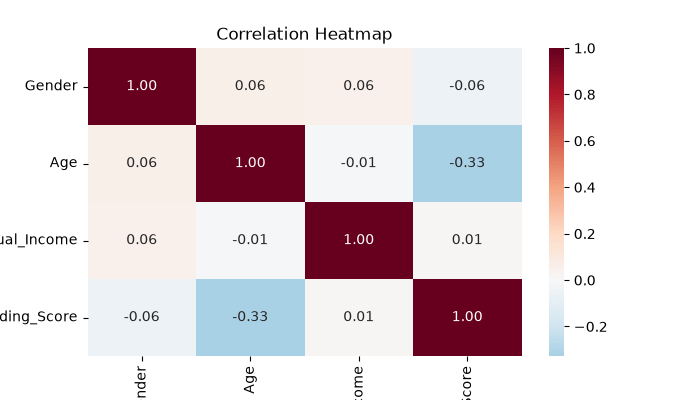
</div>

Correlations are weak overall. The only notable one is **Age ↔ Spending Score (−0.33)**, so younger customers tend to spend more. Income and spending are almost uncorrelated (0.01), so linear models would miss the structure that clustering reveals.

## 🔴 K-Means Clustering

### Choosing k

<div align="center">
<table>
<tr>
<td align="center"><b>Elbow Method</b><br/>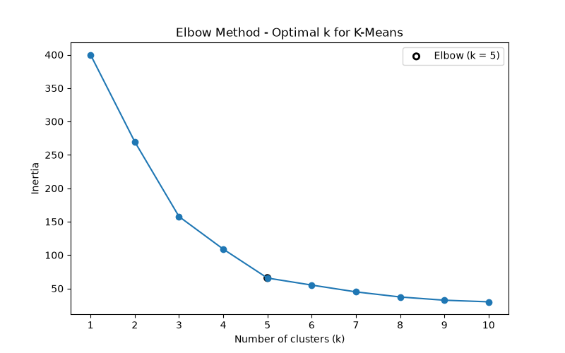</td>
<td align="center"><b>Silhouette Score</b><br/>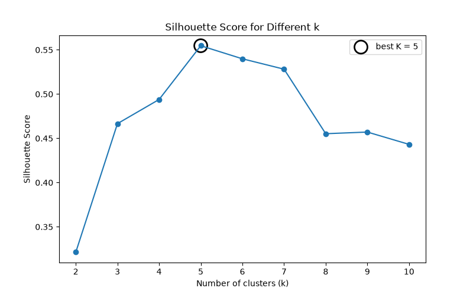</td>
</tr>
</table>
</div>

Both methods agree: **k = 5**. The inertia curve bends at k = 5, and the silhouette score peaks there at **≈ 0.55**.

### Final Clusters

<div align="center">
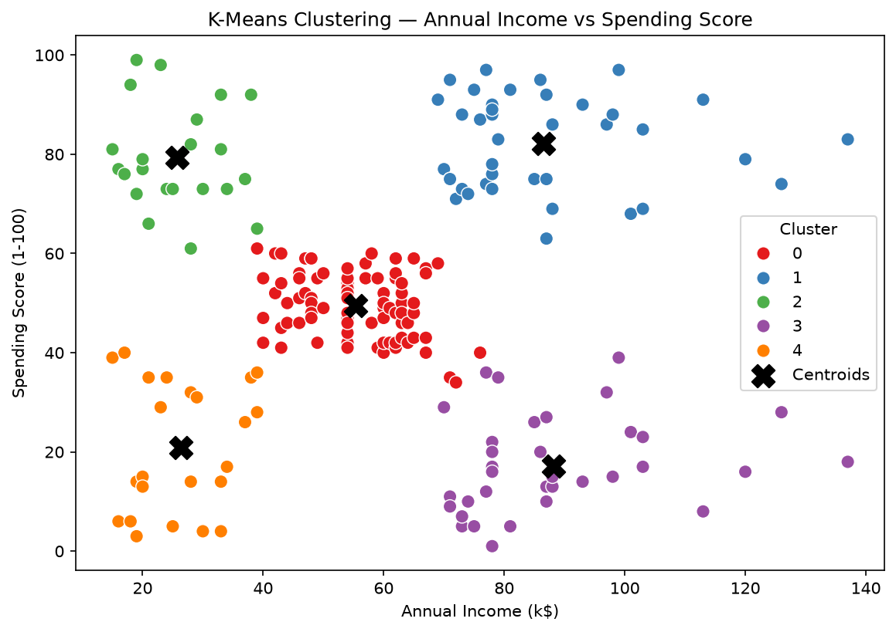
</div>

### Segment Profiles

| Cluster | Customers | Avg Age | Avg Income (k$) | Avg Spending | Segment |
|:---:|:---:|:---:|:---:|:---:|---|
| 0 | 81 | 42.7 | 55.3 | 49.5 | 🟦 **Average Customers** — mid income, mid spending |
| 1 | 39 | 32.7 | 86.5 | 82.1 | 💎 **Premium Spenders** — high income, high spending |
| 2 | 22 | 25.3 | 25.7 | 79.4 | 🛍️ **Young Enthusiasts** — low income, high spending |
| 3 | 35 | 41.1 | 88.2 | 17.1 | 💰 **Frugal Affluent** — high income, low spending |
| 4 | 23 | 45.2 | 26.3 | 20.9 | 🪙 **Budget Conscious** — low income, low spending |

> Cluster numbering can differ between runs or library versions; the segment definitions stay the same.

## 🌳 Agglomerative Hierarchical Clustering

<div align="center">
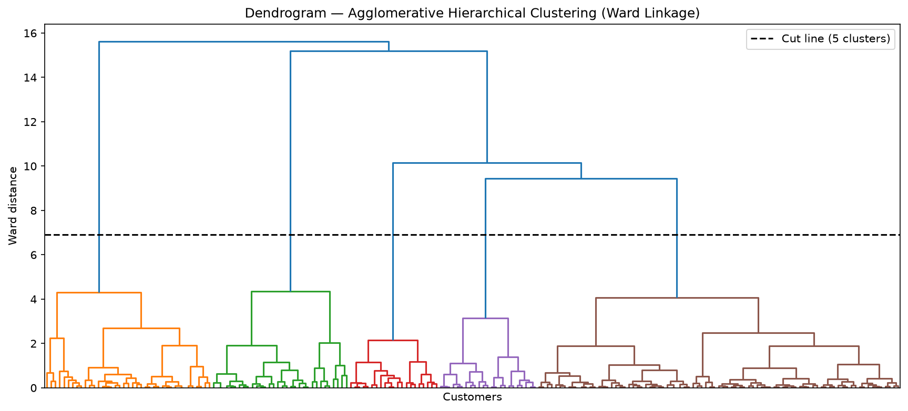
</div>

**Ward linkage** merges the pair of clusters that causes the smallest increase in total within-cluster variance. Cutting the dendrogram at the longest vertical gap gives **5 clusters**.

<div align="center">
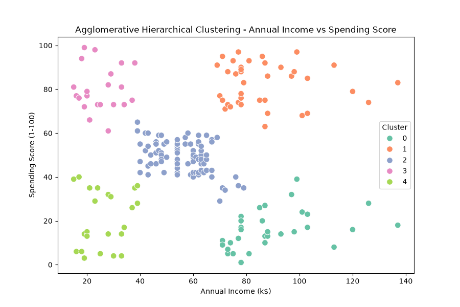
</div>

### K-Means vs Hierarchical

<div align="center">
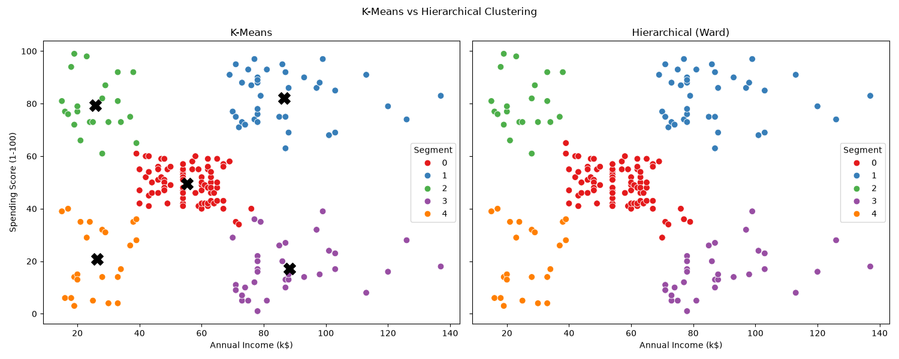
</div>

The two methods produce **almost identical segments** (silhouette 0.555 vs 0.554). Differences appear only for border customers where clusters meet. K-Means assigns by distance to a centroid, while Ward builds clusters bottom-up by connectivity.

## ⚫ DBSCAN

### Estimating `eps`

<div align="center">
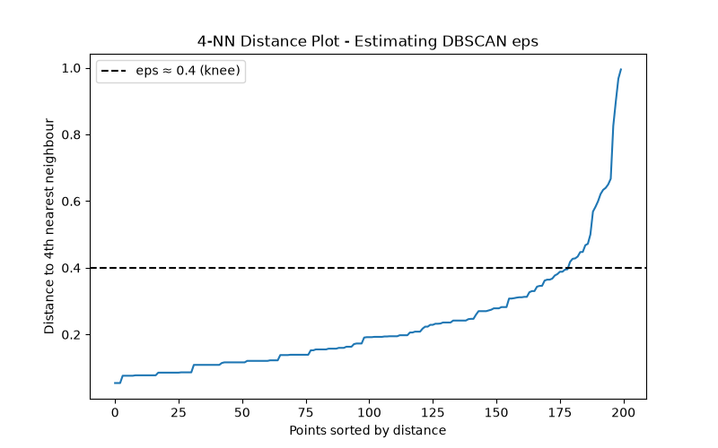
</div>

The knee of the sorted 4-nearest-neighbour distance curve suggests **eps ≈ 0.4**.

### Final Clusters

<div align="center">
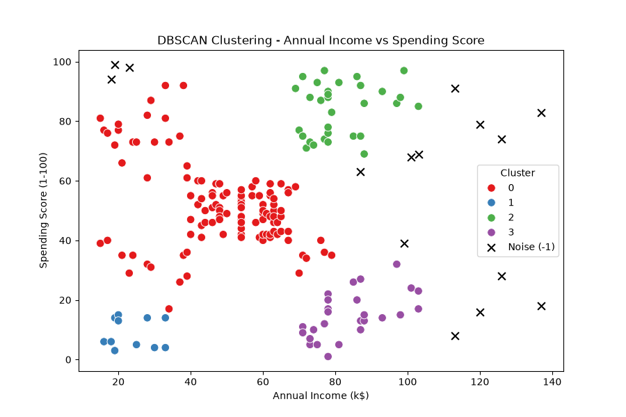
</div>

| Parameter | Value |
|---|---|
| `eps` | 0.4 |
| `min_samples` | 5 |
| Clusters found | 4 |
| Noise points | 15 (labelled `-1`, shown as ✖) |
| Silhouette (excl. noise) | ≈ 0.48 |

DBSCAN needs no preset *k* and flags low-density customers as noise. Because the two low-income segments sit close together, it merges them into one dense region, giving 4 clusters instead of 5. The extreme high-income customers become noise.

## ⚖️ Algorithm Comparison

| Algorithm | Clusters | Silhouette | Needs k? | Handles Noise? | Strength |
|---|:---:|:---:|:---:|:---:|---|
| **K-Means** | 5 | **≈ 0.555** | ✅ Yes | ❌ No | Fast, interpretable centroids |
| **Hierarchical (Ward)** | 5 | ≈ 0.554 | ✅ Yes (cut level) | ❌ No | Dendrogram hierarchy |
| **DBSCAN** | 4 + noise | ≈ 0.48 | ❌ No | ✅ Yes | Arbitrary shapes, outlier detection |

**Verdict:** K-Means and Hierarchical clustering agree on the same five segments, and those segments are the most stable across all three algorithms. K-Means is recommended for deployment because it is simple, fast and easy to explain.

## 💼 Business Insights

| Segment | Recommended Marketing Action |
|---|---|
| 💎 **Premium Spenders** (high income, high spend) | VIP loyalty programme, early access to new collections, personalised offers |
| 🛍️ **Young Enthusiasts** (low income, high spend) | Budget promotions, student/youth discounts, trend-driven campaigns, buy-now-pay-later |
| 🟦 **Average Customers** (mid income, mid spend) | Seasonal sales, bundle deals, points-based rewards to lift spending |
| 💰 **Frugal Affluent** (high income, low spend) | Re-engagement campaigns, premium experiences, exclusive events to unlock their purchasing power |
| 🪙 **Budget Conscious** (low income, low spend) | Clearance sales, value coupons, low-cost footfall drivers |

**Algorithm recommendation:** use **K-Means** for deployment (most interpretable), **Hierarchical** for management presentations that need a hierarchy, and **DBSCAN** when cluster shapes are unknown or outlier detection matters.

## 🎬 Demo Video

<div align="center">

[](https://drive.google.com/file/d/1UbVq952eUp7kKtN1cpgjQ-H4GSJmF0Qw/view?usp=sharing)

</div>

A walkthrough of the complete project: dataset and EDA, choosing k for K-Means, reading the dendrogram, tuning DBSCAN, and the final business insights.

| | |
|---|---|
| **Format** | Face + screen recording |
| **Duration** | ~5–10 minutes |
| **Covers** | Preprocessing · K-Means · Hierarchical · DBSCAN · Comparison · Business insights |
| **Link** | [Open in Google Drive](https://drive.google.com/file/d/1UbVq952eUp7kKtN1cpgjQ-H4GSJmF0Qw/view?usp=sharing) |

## 📁 Repository Structure

```
📦 Unsupervised-Learning
 ┣ 📂 Dataset
 ┃ ┗ 📄 Mall_Customers.csv
 ┃ 
 ┣ 📂 Notebook
 ┃ ┗ 📓 Mall_Customer_Segmentation.ipynb
 ┃ 
 ┣ 📂 Images
 ┃ ┣ 🖼️ 01_histograms.png 
 ┃ ┣ 🖼️ 02_pairplot.png
 ┃ ┣ 🖼️ 03_correlation_heatmap.png
 ┃ ┣ 🖼️ 04_elbow_method.png
 ┃ ┣ 🖼️ 05_silhouette_scores.png
 ┃ ┣ 🖼️ 06_kmeans_clusters.png
 ┃ ┣ 🖼️ 07_dendrogram.png
 ┃ ┣ 🖼️ 08_hierarchical_clusters.png
 ┃ ┣ 🖼️ 09_kmeans_vs_hierarchical.png
 ┃ ┣ 🖼️ 10_k_distance_plot.png
 ┃ ┗ 🖼️ 11_dbscan_clusters.png
 ┃ 
 ┣ 📂 Reports
 ┃ ┣ 📕 Theory Report.pdf
 ┃ ┗ 🌐 HTML Report.html
 ┃ 
 ┣ 📄 requirements.txt
 ┃ 
 ┗ 📄 README.md
```

## ⚙️ Installation & Usage

```bash
# 1. Clone the repository
git clone https://github.com/RENSEE-GAJIPARA/<your-repo-name>.git
cd <your-repo-name>

# 2. Create and activate a virtual environment
python -m venv .venv
.venv\Scripts\activate        # Windows
# source .venv/bin/activate   # macOS / Linux

# 3. Install dependencies
pip install -r requirements.txt

# 4. Launch the notebook
jupyter notebook Notebook/Mall_Customer_Segmentation.ipynb
```

> Run **Kernel → Restart & Run All** to reproduce every figure. The exported HTML report in `Reports/` can be read without Jupyter.

## 🛠️ Tech Stack

| Library | Version | Purpose |
|---|---|---|
|  | 3.0.5 | Data loading and manipulation |
|  | 2.5.3 | Numerical computing |
|  | 3.11.2 | Plotting |
|  | 0.13.2 | Statistical visualisation |
|  | 1.9.1 | K-Means, Agglomerative, DBSCAN, metrics |
|  | 1.18.1 | Linkage and dendrogram |

## 👤 Author

<div align="center">

**RENSEE GAJIPARA**
B.Tech — Artificial Intelligence & Data Science, Surat

[](https://www.linkedin.com/in/rensee-gajipara)
[](mailto:renseegajipara@gmail.com)
[](https://github.com/RENSEE-GAJIPARA)

⭐ If you found this project useful, consider giving it a star!


</div>
